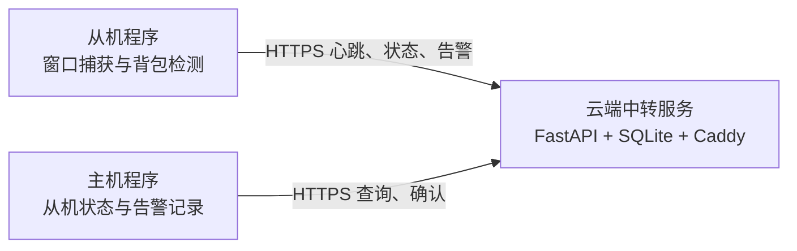

# 梦幻西游背包监控

## V1.8.2：主机监控与告警分区

主机界面调整为“监控、告警、从机管理、监控日志”四个独立板块。监控列表将现金金额和金额确认时间合并为一列，金额为主要内容、确认时间为次要内容；移除每行“最后更新”，改为在列表外统一显示本次更新时间。详见 [发版记录](docs/19-v1.8.2-release.md)。

## V1.8.1：仅保留角色现金监控

移除游戏币统计页面及每日、每小时收支统计，停止从机统计采集。仅识别并上报各角色当前现金，保留连续三帧确认、最后确认时间与不可读时的“上次确认”提示；不再识别、上报或展示存银。服务端兼容旧版统计请求但不再生成统计，历史表保留，不执行数据删除。以下版本说明为历史发布记录。

修复从机缓存文件短暂被占用时出现“拒绝访问”弹窗的问题：保存失败后保留内存队列、继续上报，并每 5 秒自动重试保存。2026-10-22 已部署服务端 2.5.1，主机、从机签名更新通道已切换至 V1.8.1，旧版可自动更新。升级重启后需重新添加监控窗口，详见 [发版记录](docs/18-v1.8.1-release.md)。

## V1.8.0：角色现金收购统计

主机新增“游戏币统计”：按账号 ID 查看北京时间的每日汇总和自然小时记录，现金增加计补入、减少计收购支出；监控中断后重新建立基线，不跨中断计算。展示未监控净变动和覆盖时长，不为未监控小时补零。详见 [统计口径与限制](docs/16-cash-statistics.md)。服务端已升级至 2.5.0，主机、从机统一为 V1.8.0。沿用现有签名密钥，V1.7.1 可自动升级。升级后需重新添加监控窗口，统计从新版本首个有效金额开始，旧版未记录的收支不能补算。

- [下载 V1.8.0 从机](https://jiankong.maipi.top/api/v1/updates/download/slave/V1.8.0)
- [下载 V1.8.0 主机](https://jiankong.maipi.top/api/v1/updates/download/master/V1.8.0)

## V1.7.1：游戏币识别修复

使用实际游戏截图补全 0～9 数字模板，修复 V1.7 的部分数字无法识别及混淆问题。金额框右侧空白处的鼠标不再阻断识别，现金、存银独立确认；背包网格定位可作为标题识别的后备路径。新增 6 个实际角色金额的回归测试，详见 [修复验证](docs/15-v1.7.1-money-fix.md)。

V1.7.1 为历史版本，当前下载请使用上方 V1.8.0 链接。

V1.7.0 及使用现有签名密钥的旧版本可自动更新。升级后仍需重新添加监控窗口。服务端继续使用 2.4.0。

## V1.7.0：角色游戏币金额

从机本地读取背包现金、存银，连续 3 帧一致才确认。主机按角色展示现金、存银及金额确认时间，不可读时显示上次确认值。真实样本对数字 2、3、6、7 的覆盖不足，相关字形仍需更多实际截图验证，详见 [识别边界](docs/13-money-recognition.md)。手机 H5 暂未增加金额展示。

主机、从机统一为 V1.7.0；服务端为 2.4.0。沿用现有更新签名密钥，V1.4/V1.5/V1.6 可自动升级。升级重启后需重新添加监控窗口。

V1.7.0 为历史版本，当前下载请使用上方 V1.7.1 链接。

## V1.6.0：紧凑从机界面

从机完整界面由 800×632 缩小为 600×560，角色卡片改为三列；6 个角色分两行展示，更多角色滚动查看。保留 300×90 迷你界面、后台监控、检测、告警和监控日志。
主机、从机统一发布 V1.6.0，沿用现有更新签名密钥，V1.4.0/V1.5.0 支持自动升级。升级重启后需重新添加监控窗口。

V1.6.0 为历史版本，当前下载使用上方 V1.7.0 链接。

本次未修改自动更新的下载超时、重试和断点续传逻辑。

## V1.5.0：游戏面板识别与自动更新

新增背包、给予、交易、属性、摊位、摊位记录和默认游戏界面识别，
并将带北京时间、区服和角色的操作记录接入本地文本日志及云端监控日志。
640×480 的背包定位已修正；提供的 80 张原始截图分类全部通过，
另有 80 次保持原生 UI 大小、平移至 800×600 画布的验证通过。
2026-10-20 已同步发布主机/从机 `V1.5.0`、服务端 `2.3.0` 与新版 H5。
沿用 V1.4.0 的 RSA 更新密钥，在线 V1.4.0 客户端可在启动检查或每 10 分钟的检查周期自动升级，
保留 `runtime/` 的账号、配对、设置和日志。V1.3.0 及更早版本因旧密钥不再可用，需要手动安装一次当前版本。
升级会重启程序；现有手动添加游戏窗口的启动规则不变，更新后需重新添加要监控的窗口。

V1.5.0 为历史版本，首次安装请使用上方 V1.6.0 下载链接。

识别码、确认规则和验证方法见 [面板识别说明](docs/10-panel-recognition.md)。

## V1.4.0 监控日志

V1.4.0 首次引入 Windows 主机和手机 H5 的“监控日志”页，
显示从机名称/编号、区服/角色、发生时间、日志类型、遮挡百分比、最小化状态和操作原因，
每页 100 条，支持查看最新记录和更早记录。

- 每次 5 秒状态上报中，遮挡比例大于 0 或窗口最小化时，服务端分别追加对应日志；
  正常状态不追加。相同快照重传不会重复记录，不同时间的异常快照会持续留档。
- 启动程序、点击开始、点击暂停、正常关闭程序时，记录开始/暂停及对应原因；
  这些是整台从机的操作，未添加游戏窗口时也记录。
- 开始/暂停日志先保存到 `runtime/monitor-log-outbox.json`，发送成功才移除，
  断网时保留并重试。正常关闭最多等待 2 秒发送，失败后下次启动补传。
  强制结束进程、断电或崩溃无法保证产生关闭记录，仍通过心跳超时判断离线。
- 监控日志独立于背包告警，不需要确认，也不触发弹窗、铃声或 Bark 推送。
- 遮挡百分比上传保留原始精度；小于 0.1% 的遮挡显示为 `<0.1%`，避免红色文字却显示 0.0%。
- 暂停背包分析时仍在状态上报前重新测量窗口遮挡和最小化状态，检测失败不沿用旧遮挡值。

2026-10-19 已部署服务端 `2.2.0`、H5，并发布主机和从机 `V1.4.0` 签名安装包。
本次因原签名私钥遗失而更换了更新密钥：`V1.2.0`、`V1.3.0` 客户端必须手动安装一次
`V1.4.0`，之后继续沿用新密钥自动升级。关闭旧程序、将完整 ZIP 解压到新目录，再把旧目录的
整个 `runtime/` 复制合并到新目录，保留旧设置即可保留登录、从机身份和配置。主机及全部从机均需升级。

原 V1.4.0 包保存在服务器回滚备份中；首次安装或手动升级请下载上方当前版本。

旧版客户端上报的遮挡和最小化也会记录；开始/暂停操作日志需要升级到 `V1.4.0` 客户端。

这是一个面向 Windows 的《梦幻西游》多窗口背包监控系统。每台从机最多监控 8 个游戏窗口，本地判断背包是否打开、是否已满，并可通过 HTTPS 云端中转把状态和告警发送到主机。

当前桌面产品入口只保留背包监控，不展示装备识别、OCR、YOLO、聊天室、商行或个人中心等历史实验功能。核心检测使用 OpenCV，在本机完成，不上传游戏截图。

## 系统组成



- **从机程序**：运行在游戏电脑上，负责最多 8 个窗口的捕获、检测和本地告警；断网时仍可独立工作。
- **云端中转服务**：保存设备心跳、最新窗口状态和告警记录，不保存游戏截图。
- **主机程序**：展示所有从机窗口的最新状态，接收告警并标记为已处理。

## 当前能力

- 手动添加 0～8 个标题包含“梦幻西游 ONLINE”的窗口，拦截其他程序窗口。
- 从窗口标题解析二级区名、角色名和角色 ID。
- 检测背包未打开、未满、接近满、已满和被游戏界面遮挡。
- 检测 Windows 窗口最小化及遮挡比例。
- 所有异常连续保持约 5 秒后才告警，减少游戏临时提示造成的误报。
- 支持暂停/恢复监控、一键最小化全部游戏窗口、后台监控以及右下角持久告警弹窗。
- 从机、主机和设置窗口使用统一的深色仪表盘界面，通过卡片、状态色和按钮层级突出重点信息。
- 支持仅弹窗或弹窗并循环播放声音，用户确认后才停止。
- 从机每 5 秒上报状态；主机保留未处理和已处理告警记录。
- 主机与从机共用同一个客户端版本号，当前为 `V1.8.0`；主机“从机管理”会提示版本不匹配。
- 从机支持 `300×90` 迷你界面，只显示监控/暂停状态、监控窗口数量和恢复按钮；切换界面不会重启检测、云端连接或告警。
- V1.2.0 起支持在线自动更新：启动后检查一次，运行期间每 10 分钟检查一次；发现更高版本后自动下载、校验、安装并重启。

## 当前发布状态

| 组件 | 当前版本 | 状态 |
| --- | --- | --- |
| Windows 主机 / 从机 | `V1.8.0` | 已签名发布，支持从 V1.4.0 自动升级 |
| 云端中转服务 | `2.5.0` | 已部署至 `https://jiankong.maipi.top`，支持面板日志和新版 H5 |
| 在线更新清单 | `V1.8.0` | `https://jiankong.maipi.top/api/v1/updates/latest` |

V1.1.0 及更早版本不包含独立更新器，需要手动安装一次 V1.2.0；从 V1.2.0 开始，后续版本由程序自动感知并完成升级。

## 版本更新记录

- `V1.5.0`：新增七类界面识别、带北京时间的面板操作日志与本地文本日志；修复 640×480 背包定位；主机和 H5 支持面板日志，沿用 V1.4.0 密钥自动更新。

- `V1.4.0`：新增云端监控日志及 Windows/H5 历史查询，记录遮挡、最小化和开始/暂停操作；保留微小遮挡精度，支持操作日志断网补传；修复 64 位窗口句柄枚举，更换更新签名密钥。

- `V1.3.0`：从机背包告警方式改为互斥单选：不提醒、仅主机推送、仅本机提醒；本机提醒不会再同时向主机写入告警。
- `V1.2.0`：主机和从机加入签名在线更新、失败回滚与配置保留；服务端加入公开版本清单和分角色安装包下载接口。
- `V1.1.0`：从机加入固定 `300×90` 迷你模式，可在不中断检测、连接和告警的情况下切换完整界面。
- `V1.0.0`：完成多窗口背包监控、云端状态中转和主机告警的首个统一版本。

## 客户端版本规则

- 主机和从机必须同步发布、同步递增，始终保持完全相同的版本号。
- 版本号统一使用 `V主版本.次版本.修订版本` 格式，本轮从 `V1.0.0` 开始。
- 修复问题递增修订版本，例如 `V1.0.0 → V1.0.1`；增加兼容功能递增次版本，例如 `V1.0.1 → V1.1.0`；存在不兼容的大改版时递增主版本。
- 每次发布必须先修改 `src/hoyo_analyzer/__init__.py` 中的唯一版本常量，再同时重新打包主机和从机。打包脚本会核对两个包内的版本，并把统一版本写入 `release-manifest.json`。

## 在线自动更新

V1.1.0 本身不包含更新器，因此必须手动安装一次 V1.2.0。此后 V1.2.0、V1.3.0 及更高版本可以沿用同一机制自动升级。主机和从机均在程序启动约 1 秒后检查一次，之后每 10 分钟检查一次；没有网络、服务端没有发布包或检查失败时，现有监控继续运行，不会强制退出。

发现更高版本时，程序自动下载对应的主机包或从机包，并依次校验 HTTPS 来源、RSA-3072 发布签名、文件大小和 SHA-256。校验全部通过后，独立的 `梦幻西游自动更新.exe` 会等待主程序安全退出，保留整个 `runtime/`（包括账号会话、从机身份、用户设置、事件和日志），替换其余程序文件并重启。新版本在 60 秒内无法成功启动时会恢复旧文件并重新打开旧版本。更新期间监控会短暂停止一次。

发布签名私钥位于本机构建目录 `runtime/update-signing-private.json`，已被 Git 忽略。必须把它备份到安全的离线位置，不能提交、发送给客户端或放入服务器公开目录；丢失后，已经发布的 V1.2.0 客户端将无法信任使用新密钥签名的后续版本。

## 程序会判断什么

- `背包未打开`：画面中没有检测到完整背包，提醒员工打开背包。
- `背包未满`：背包中仍有空格。
- `背包接近满`：只剩很少的空格。
- `背包容量`：默认在 20 个格子全部占用时警告，也可以设置为剩余 1～20 格时提前警告。
- `背包被遮挡，无法检测`：背包打开但被聊天、属性或其他界面遮挡，提醒员工处理。
- `检测已暂停`：游戏窗口被最小化；恢复窗口后自动继续，最小化期间不会沿用旧画面更新背包结论。
- `窗口遮挡`：每 2 秒根据 Windows 窗口层级和重叠面积计算一次，在对应的窗口输出中显示遮挡百分比和最小化状态，不展示遮挡来源。

主界面内容区固定为 800×600，加上 32px 深色标题栏后完整窗口为 800×632，减少对游戏窗口的遮挡。程序每 3 秒重新扫描一次窗口，最多同时监控 8 个游戏窗口。程序启动时保持 0 个监控窗口，必须点击顶部的“增加窗口”按钮，手动选择包含正确账号信息的游戏窗口。界面不再设置重复的“已捕获窗口”区域；每套窗口输出直接显示二级区名、角色名称、移除按钮、实时画面、背包状态、空格数、已拥有数、置信度、遮挡百分比和最小化状态。输出采用 4 列 × 2 行紧凑布局，8 个窗口可以同时显示且无需滚动。

“增加窗口”的候选列表只接受标题中包含“梦幻西游 ONLINE”（允许中间有空格）的窗口，非游戏窗口不会出现。窗口输出会从游戏窗口标题中读取账号信息。例如：

- `江苏1区[秦淮风光]`：显示二级区名“秦淮风光”。
- `清风知夏[54588235]`：显示角色名“清风知夏”，并保留角色 ID `54588235`。

## 从机、云端与主机通信

本程序定位为“从机”，无需互联网或主机即可独立完成窗口捕获和背包检测。点击顶部“设置”打开单独的从机设置窗口：

- `背包容量`：使用三个互斥单选项。1“不提醒”；2“主机推送”，仅向主机写入告警；3“本机提醒”，仅在从机弹窗并循环播放声音，直到手动确认。达到可设置的剩余空格阈值并连续确认 5 秒后执行所选方式。主机收到第 2 档告警后是否弹窗与播放声音，仍由主机自己的“是否弹窗提醒”设置决定。
- `从机配对`：云端地址已经内置，不需要填写 IP、端口、HTTP/WebSocket 或 HTTPS 地址。主机在“从机管理”中生成 6 位一次性配对码，从机输入并保存后自动取得独立设备身份。配对码 5 分钟过期且只能使用一次。

游戏窗口最小化、窗口遮挡、背包未打开和背包被遮挡仍会显示在从机与主机状态板块，但不再触发告警。设置保存在 `runtime/slave_settings.json`。从机无论是否触发告警，都会每 5 秒上传当前全部监控窗口的状态快照；移除窗口后，云端对应行也会随快照移除。所有连接都由电脑主动向云端发起，家庭和公司路由器不需要开放端口。从机始终保留离线独立运行能力。

主机先注册或登录账号，默认每 5 秒刷新；不同主机账号的数据严格隔离。程序包含两个页面：

- **从机状态**：从机编号、窗口/角色、当前状态、空格、置信度、遮挡百分比、最小化、最后更新、在线状态。每个游戏窗口一行，没有添加游戏窗口的从机也会占一行。90 秒没有上报显示离线；最小化或暂停时不把旧的空格数、置信度当成当前检测结果。
- **告警记录**：编号、从机、区服/角色、告警、发生时间、未处理/已处理、确认操作。确认后记录保留，只隐藏按钮；重启主机后仍可读取云端历史。主机“设置”中新增“弹窗提醒”开关，只有勾选后，新告警才会弹窗并播放声音；关闭时记录仍会正常进入列表。云端既有保留策略为已处理记录 30 天，未处理记录不自动清理。
- **从机管理**：生成一次性配对码，查看从机名称、编号、在线状态、最后连接时间和版本，编辑名称与备注，禁用、移除或重新配对从机。若从机上报版本与主机客户端版本不同，状态栏显示“版本不匹配”；重新配对会立即使旧凭据失效。

状态同步要求同时升级服务端、从机和主机。服务端会为每个成功配对的从机自动分配唯一编号和独立凭据，用户不再手工管理或复制密钥。

全部窗口添加完成后，可以点击“后台监控”将本程序最小化，避免遮挡游戏窗口。主界面最小化后所有游戏窗口仍会继续检测；点击 Windows 任务栏中的程序图标即可恢复主界面。

需要持续查看简要状态时，可以点击“迷你版”。窗口会缩小为固定的 `300×90`，仅显示“监控中/已暂停”、当前监控窗口数量和“恢复完整界面”按钮。迷你模式只改变界面显示，不会停止或重启检测线程、云端连接、本机告警或 Bark/主机告警，也不会改变进入前的暂停状态；恢复后回到原完整尺寸和进入迷你模式前的位置。

需要手动整理背包时，可以点击顶部“暂停监控”。暂停后所有游戏窗口停止背包分析和告警；操作完成后点击“开始监控”恢复。恢复时会清空暂停前尚未完成的连续命中计时，背包已满必须重新连续保持 5 秒才会告警。

需要快速隐藏游戏窗口时，可以点击顶部“一键最小化”。程序会先暂停监控，再重新扫描 Windows 桌面并最小化当前电脑上的全部“梦幻西游 ONLINE”窗口，包括没有加入监控列表的窗口。该操作不会把未监控窗口自动加入监控；恢复游戏窗口后，仍需手动点击“开始监控”才会继续检测。

## Windows EXE

### 直接使用

打包后的目录是：

```text
dist/
├─ 梦幻西游背包监控/
│  ├─ 梦幻西游背包监控.exe
│  ├─ 梦幻西游自动更新.exe
│  ├─ _internal/
│  ├─ assets/
│  └─ configs/
├─ 梦幻西游告警主机/
│  ├─ 梦幻西游告警主机.exe
│  └─ 梦幻西游自动更新.exe
├─ 梦幻西游背包监控.zip
├─ 梦幻西游告警主机.zip
└─ release-manifest.json
```

`dist/` 是唯一规范发布目录。每次运行打包脚本都会清空该目录、重新生成两个完整程序目录和两个固定名称 ZIP，并写入统一客户端版本、自检结果、ZIP SHA-256 和 RSA 发布签名；打包时还会验证更新器、签名以及主机与从机包版本一致。不要再手工创建 `dist-*` 历史目录。主机程序负责显示从机状态、持续提醒和确认从机告警，不执行游戏画面检测。

请整体复制这个目录，不要只复制 EXE。双击 `梦幻西游背包监控.exe` 即可运行。

重新打包：

```powershell
powershell -ExecutionPolicy Bypass -File scripts/build_windows.ps1
```

打包脚本不会复制本机 `runtime` 中的登录会话或设备凭据，因此主机包和从机包都是可重复分发的通用安装包。主机安装后注册/登录账号；从机安装后输入对应主机生成的一次性配对码。

仅调试本机配置时可以使用 `-IncludeLocalSettings`。该模式会带入登录会话和设备凭据，不能公开分发、上传 GitHub 或复制给其他电脑：

```powershell
powershell -ExecutionPolicy Bypass -File scripts/build_windows.ps1 -SkipInstall -IncludeLocalSettings
```

跳过依赖安装、直接重新构建：

```powershell
powershell -ExecutionPolicy Bypass -File scripts/build_windows.ps1 -SkipInstall
```

打包前请先退出正在从 `dist/` 运行的旧程序，避免 Windows 占用文件。`-OutputDirectory` 仅用于临时诊断，正式发布始终使用默认的 `dist/`。

完成正式构建后，把两个 ZIP 和清单复制到服务端的 `server/releases/` 再重新部署服务：

```powershell
Copy-Item dist/*.zip,dist/release-manifest.json server/releases/ -Force
```

服务器只公开发布清单和清单中当前版本对应的两个安装包。不要把 `runtime/update-signing-private.json` 复制到服务器。

打包自检会验证从机的 Qt、OpenCV、Windows Graphics Capture，以及主机的 Qt、音频和 TLS。也可以手动运行：

```powershell
& "dist/梦幻西游背包监控/梦幻西游背包监控.exe" --package-self-test
Get-Content "dist/梦幻西游背包监控/runtime/package-self-test.json"
```

## 本地开发

要求 Windows 10/11、Python 3.11 或更新版本。

```powershell
python -m venv .venv
.venv\Scripts\python.exe -m pip install -e ".[dev]"
.venv\Scripts\python.exe -m hoyo_analyzer.inventory_app
```

运行测试：

```powershell
.venv\Scripts\python.exe -m pytest
```

服务端测试需要在 `server` 目录执行：

```powershell
Set-Location server
..\.venv\Scripts\python.exe -m pytest -q
```

## 云端部署

服务端要求 Ubuntu 24.04、Docker 和可访问的公网 IP。账号、会话、配对码和设备凭据都由服务端保存和签发；旧版环境变量密钥只用于升级期间兼容旧客户端：

```bash
cd server
cp .env.example .env
docker compose up -d --build
```

也可以在全新的 Ubuntu 24.04 服务器上执行：

```bash
cd server
chmod 700 deploy.sh
./deploy.sh <服务器公网 IP>
```

脚本会配置 Docker、Caddy 及无域名 IP HTTPS。部署细节见 [`server/README.md`](server/README.md)。

## 配置主机和从机

1. 公司电脑打开主机程序，注册或登录主机账号。
2. 打开“从机管理”，点击“添加从机”，取得 6 位一次性配对码。
3. 游戏电脑打开从机“设置”，输入配对码并保存。
4. 看到“云端：已连接”后，从机通常会在主机下一个 5 秒刷新周期出现。
5. 另一位用户注册自己的主机账号并独立配对从机，双方数据互不可见。

## 配置和运行数据

主要配置在 `configs/default.toml`：

- 游戏窗口必须在标题中包含“梦幻西游 ONLINE”；程序会自动兼容其中的空格。
- `sampling.normal_fps`：每秒分析次数，默认 5 次。
- `inventory_monitor.confirm_frames`：连续多少帧一致后确认状态。
- `inventory_monitor.alert_confirm_seconds`：任一告警状态连续保持多少秒才告警，默认 5 秒；中途恢复就重新计时。
- `inventory_monitor.full_cooldown_seconds`：背包已满提醒的最短间隔。
- `inventory_monitor.closed_grace_seconds`：启动后等待员工打开背包的时间。
- `inventory_monitor.closed_reminder_seconds`：背包未打开时的重复提醒间隔。
- `inventory_monitor.invalid_reminder_seconds`：背包被遮挡时的重复提醒间隔。

事件记录保存在 `runtime/events/inventory_events.jsonl`。启动异常保存在 `runtime/startup-error.log`。

## 识别方式

检测器使用 OpenCV 和背包标题模板定位背包，再分析右侧 5×4 共 20 个物品格。该流程完全在本机运行，不上传游戏截图，也不需要模型权重。

为了保证准确率，请不要最小化游戏窗口，让背包完整显示，避免聊天框、角色属性或其他游戏内界面遮挡背包，并尽量保持游戏界面缩放比例稳定。

## 仓库结构

```text
assets/templates/        背包定位模板
configs/                 默认检测参数
packaging/               Windows 打包运行钩子和使用说明
scripts/                 桌面入口、评估及打包脚本
server/                  FastAPI 中转服务、Docker 与 Caddy 配置
src/hoyo_analyzer/       从机、主机、捕获、检测和通信代码
tests/                   桌面程序单元测试
hoyo_analyzer.spec       从机 PyInstaller 配置
hoyo_master.spec         主机 PyInstaller 配置
```

## 安全与隐私

- `runtime/`、`.env`、`deployment-credentials.json`、证书私钥、SQLite 数据库和打包目录均被 Git 忽略。
- 云端固定地址集中保存在 `cloud_config.py`；登录密码只以 PBKDF2 摘要保存在服务端，客户端不保存密码。
- 每台从机仍使用服务端自动签发的独立凭据，但用户不需要查看或手工填写；凭据只经 HTTPS 发送。
- 游戏截图只在本机内存中分析，不上传云端。
- 提交前建议运行 `git status --short`，确认没有通过强制添加绕过 `.gitignore`。

## 已知限制

- Windows Graphics Capture 无法可靠读取已最小化窗口，因此最小化时暂停背包分析并显示状态。
- 背包必须打开且完整可见；游戏内弹窗覆盖背包会被判定为检测受阻。
- 识别效果依赖窗口尺寸、界面缩放和模板匹配，换分辨率后应先用真实截图验证。
